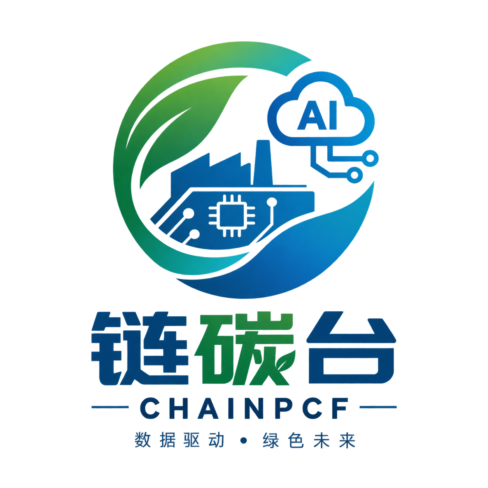

# 链碳台 CHAINPCF



> **数据驱动 · 绿色未来**
> 状态：首期骨架（已完成目录结构与文档骨架，尚无代码）

**AI 辅助的 PCBA-SMT 工序级碳数据字典、核算工具与数据包**

让中小电子制造企业以最低门槛，产出**可复核、可交付**的产品碳数据 —— 让每一块电路板组件的碳数据，从"填表"变成"资产"。

| 项 | 内容 |
| --- | --- |
| 项目名称 | 链碳台（CHAINPCF，Chain Product Carbon Footprint） |
| 一句话定位 | AI 辅助的 PCBA-SMT 工序级碳数据字典、核算工具与数据包 |
| 核算对象 | 产品碳足迹（PCBA / SMT 电子制造场景），依据 GB/T 24067-2024 |
| 参赛赛道 | 中国国际大学生创新大赛 · 高教主赛道 · 新工科类 · 本科生组创意组 |
| 承担单位 | 成都信息工程大学 · 软件工程学院 |
| 当前阶段 | 2026.10—11 需求与标准（见 [版本规划](docs/planning/README.md)） |

## 一、我们解决的问题

产品碳数据的门槛不在"算"，而在"准备"：

| 瓶颈 | 具体表现 |
| --- | --- |
| 物料清单字段不统一 | 表头、缩写、规格写法各家企业都不一样，机器读不懂，人工逐条改 |
| 活动数据缺失 | 工时、设备能耗、辅材消耗往往没有细粒度记录，只能估算 |
| 排放因子难选 | 因子来源、适用区域、版本、单位口径不一致，选错就不可复核 |
| 客户模板各异 | 同一批数据按不同客户模板反复填报，口径不可比、无法复用 |

受影响最直接的是**没有专职碳管理岗位的中小供应商**——相关活儿通常挂在品质、工程或体系工程师身上。

政策与贸易规则正在把碳数据推成供应链准入项：发改环资〔2023〕1529 号《关于加快建立产品碳足迹管理体系的意见》、生态环境部等十五部门《关于建立碳足迹管理体系的实施方案》（2024.06）、GB/T 24067-2024（2024.08 发布、2024.10.01 实施）、四部门产品碳足迹标识认证试点（2024.09，电子电器为重点品类）、欧盟 ESPR 与数字产品护照。

## 二、我们做什么

现有方案之间存在一段空白：通用 LCA 软件门槛高且缺工序级字段口径；咨询核算服务按次付费、数据难沉淀；能碳管理平台面向大型企业的整机与组织口径。**空白区 = 中小供应商的低门槛数据准备 + 工序级数据结构 + 可审计数据包交付。**

链碳台只做一件事：**把企业已有的数据，变成可交付的碳数据。**

| 层 | 内容 |
| --- | --- |
| AI 副驾驶 | 物料语义理解、工序与因子候选、缺口与异常提示、自然语言问询。**只给候选与依据，不产生正式核算数值** |
| 确定性核算发动机 | 规则约束 → 人工确认 → 确定性计算 → 版本与结果指纹。同一输入 → 同一结果，全过程留痕 |
| 交付物 | 结构化碳数据包：核算结果与活动数据、因子来源与版本、数据缺口与质量等级、修改记录与字段映射、计算指纹（可复算） |

架构、模块职责与数据流见 [架构文档](docs/architecture/README.md)，核算规则与依据见 [碳核算知识库](knowledge/README.md)。

## 三、目录导航

```text
tanliantai/
├── README.md                 # 项目介绍、快速开始、目录导航
├── AGENTS.md                 # Agent 全局规则与上下文加载入口
├── CONTRIBUTING.md           # 人与 Agent 的协作规范
├── CHANGELOG.md              # 版本变更记录
├── .gitignore / .editorconfig
├── .agents/                  # Agent 工作流与开发细则
├── .devcontainer/            # 开发容器配置
├── environment/              # 环境说明与初始化脚本
├── docs/                     # 产品与工程文档
├── knowledge/                # 碳核算知识库（术语、公式、因子、文献）
├── app/                      # 应用外壳（启动、主窗口与工作台）
├── modules/                  # 业务功能模块
├── contracts/                # 跨模块接口与数据契约
├── data/                     # 可纳入 Git 的示例与模板
├── tests/                    # 单元 / 集成 / 验收测试与基准数据
├── tools/                    # 工程辅助工具（含结构与环境自检）
├── resources/                # 品牌与应用静态资源
└── .github/                  # 协作模板与自动化检查
```

| 我想…… | 去这里 |
| --- | --- |
| 了解产品定位、MVP 范围与用户流程 | [docs/product](docs/product/README.md) |
| 看架构分层、模块职责与数据流 | [docs/architecture](docs/architecture/README.md) |
| 知道怎么开发和提交 | [docs/development](docs/development/README.md)、[CONTRIBUTING.md](CONTRIBUTING.md) |
| 查核算公式、因子与文献依据 | [knowledge](knowledge/README.md) |
| 看某个功能模块做什么 | [modules](modules/calculation/README.md) |
| 用 AI Agent 干活 | [AGENTS.md](AGENTS.md) → [.agents/context-map.md](.agents/context-map.md) |
| 让 Agent 按流程办事 | [.agents/workflows](.agents/workflows/development.md) |
| 跑一次结构与环境自检 | [tools](tools/README.md)、[environment](environment/README.md) |

## 四、快速开始

当前仓库处于**文档与结构阶段**，还没有可运行代码，因此"快速开始"是阅读与自检两条路径。

```bash
# 1. 获取仓库
git clone https://github.com/Yuanqingyuang/tanliantai.git
cd tanliantai

# 2. 校验目录结构是否完整
python tools/check_repo_structure.py

# 3. 校验本地环境（Python 版本、编码、Git、数据安全提示）
python environment/scripts/check_environment.py
```

阅读顺序建议：本 README → [产品文档](docs/product/README.md) → [架构文档](docs/architecture/README.md) → [版本规划](docs/planning/README.md)。

开发容器使用方式见 [environment/README.md](environment/README.md)；技术栈选型尚未决策，相关事项记录在 [docs/decisions](docs/decisions/README.md)。

## 五、里程碑

| 阶段 | 时间 | 主要产出 |
| --- | --- | --- |
| 一、需求与标准 | 2026.10—11 | 文献与方法学综述、需求调研、指标体系 |
| 二、数据字典与架构 | 2026.12—2027.01 | 数据字典 V0.1、数据包规范 V0.1、系统设计 |
| 三、算法与核算引擎 | 2027.02—04 | 核心算法原型、确定性核算引擎 |
| 四、数据包与实验 | 2027.05—07 | 评测报告、案例数据包、系统测试报告 |
| 五、成果固化 | 2027.08—09 | 软著、研究报告、商业计划书、结题材料 |

预期成果：软件著作权 1 项（授权）｜可运行工具原型 1 套｜工序活动数据字典 V1.0｜可审计碳数据包规范 V1.0｜评测研究报告 1 份｜评测数据集与案例集 1 套｜商业计划书 1 份。

## 六、团队

| 成员 | 分工 |
| --- | --- |
| 袁青扬（负责人） | 项目统筹；工序活动数据字典与核算规则设计 |
| 陈霖 | BOM 语义解析与 AI 辅助候选匹配 |
| 赵天志 | 确定性核算引擎与资源分摊实验 |
| 王靖凯 | 碳数据包与审计链设计、后端接口 |
| 石凌云 | Web 工作台前端与评测实验实施 |
| 王嘉昀（指导教师，讲师） | 成都信息工程大学 软件工程学院 |

## 七、协作与规范

- **人**：先读 [CONTRIBUTING.md](CONTRIBUTING.md)，按分支、提交与 PR 规范提交变更。
- **AI Agent**：先读 [AGENTS.md](AGENTS.md)，按 [.agents/context-map.md](.agents/context-map.md) 加载对应资料，按 [.agents/workflows](.agents/workflows/development.md) 执行流程。
- **硬性红线**：核算公式、排放因子、系统边界与分摊方法的任何改动都必须有标准或文献依据并登记；AI 不产生正式核算数值；企业真实 BOM 与工艺数据不得提交进 Git。

## 八、许可与声明

- 代码与文档的授权方式【待确认】：由项目负责人确定后在此补充许可协议。
- `docs/product/` 下的项目计划书与答辩材料为团队原创作品，仅用于本项目参赛与结题。
- `knowledge/` 下的标准与文献信息仅作研究引用，具体条文与数值以官方正式发布为准。
